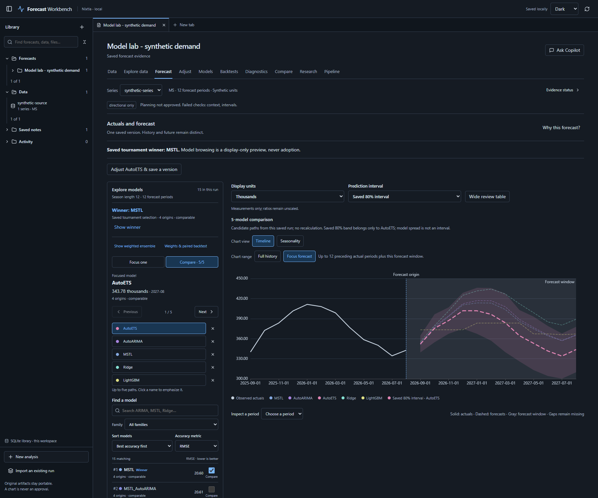
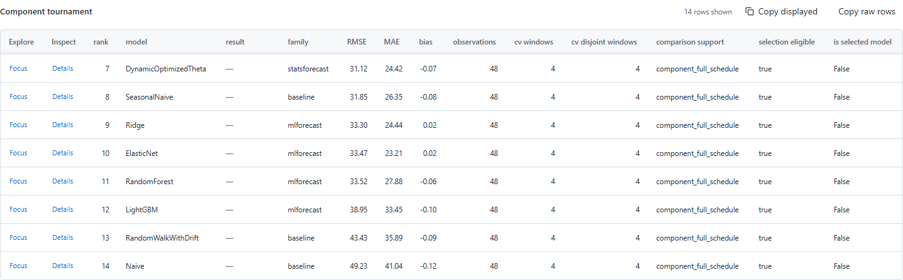
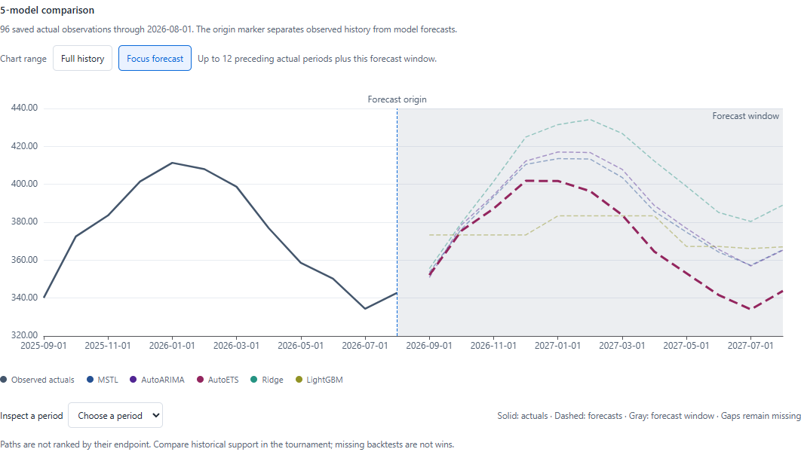
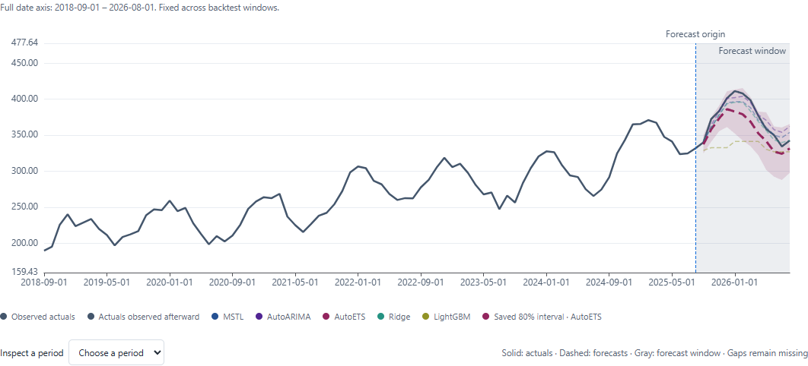
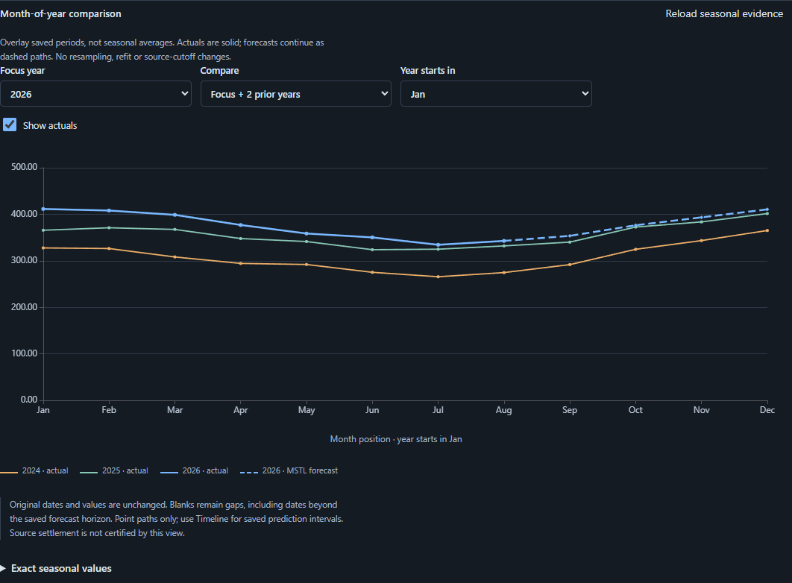
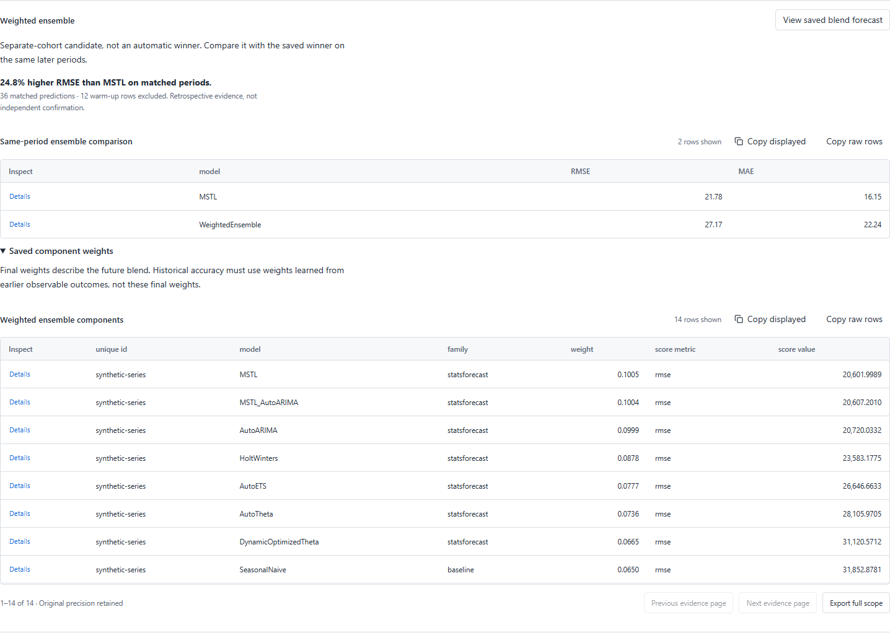
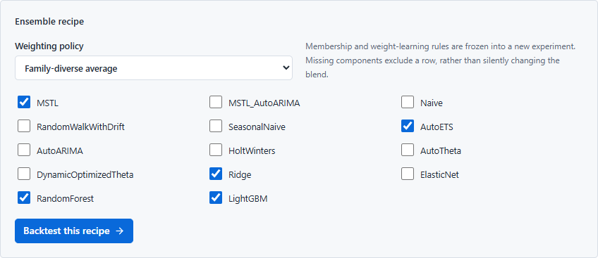
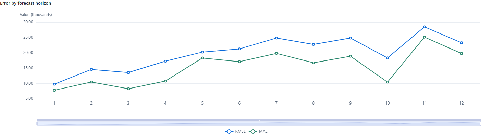

# nixtla-scaffold

**Compare models. Test ensembles. Understand the forecast.**

Nixtla provides the forecasting building blocks. **This wrapper turns them into
a repeatable analyst workflow:** inspect data, compare candidates, challenge the
result, and preserve the evidence needed to explain and refresh it. Less time
wiring libraries and files together; more time deciding whether a forecast is usable.

**The Forecast Workbench canvas for GitHub Copilot is the primary viewer:** your
data library, model arena, backtests, diagnostics, ensemble builder and research
workspace in one place. The engine also runs independently through the CLI or
Python API.

[](docs/workbench/forecast-canvas.png)

*Real canvas, generated synthetic data: 96 monthly observations, 14 component
models, one separately evaluated ensemble and four 12-month backtest origins.
These are UI demonstrations, not business results or model benchmarks.
Click any image for the full-size view.*

## More than one model family

| Approach | Examples |
| --- | --- |
| Statistical forecasting | AutoARIMA, AutoETS, Holt-Winters, Theta, MSTL; eligible MFLES, CES and TBATS candidates |
| Machine learning | Ridge, ElasticNet, Random Forest, LightGBM and other installed MLForecast learners |
| Simple and sparse-demand baselines | Naive, SeasonalNaive, drift, Croston, ADIDA, IMAPA and TSB |
| Ensembles | Equal, fixed, prior-error, top-k and family-diverse recipes; opt-in experimental greedy search |

Candidates depend on data support, policy and installed dependencies. The demo
includes statistical, ML and baseline candidates scored on the same origins;
ensembles get a separate matched-period comparison. Browse the whole roster,
then overlay up to five paths without changing the saved winner.

[](docs/workbench/canvas-model-tournament.png)

## Follow the evidence

| See where models disagree | Replay what would have happened |
| --- | --- |
| [](docs/workbench/canvas-model-comparison.png) | [](docs/workbench/canvas-backtest-replay.png) |
| Compare shape, turning points and endpoints—not just a single accuracy score. | Move between historical origins and compare predictions with the outcomes observed later. |

| Put the forecast in seasonal context | Make ensembles earn their place |
| --- | --- |
| [](docs/workbench/canvas-seasonal-overlay.png) | [](docs/workbench/canvas-ensemble-evidence.png) |
| Overlay prior periods with the forecast. Daily data also supports weekday-aligned month comparisons. | Inspect paired errors and saved weights. This demo's blend loses; it does not replace the winner. |

| Build a blend worth testing | Find the weak forecast horizons |
| --- | --- |
| [](docs/workbench/canvas-ensemble-recipe.png) | [](docs/workbench/canvas-error-diagnostics.png) |
| Freeze members and a weighting policy, then backtest. The pictured custom recipe is a draft, not a scored result. | See how errors change with forecast distance instead of hiding them in one average. |

## What the wrapper adds

- **Less setup and glue code:** the analyst-first skill inspects supplied data,
  chooses feasible defaults and asks only about consequential ambiguity.
- **Comparable evidence, not just more models:** common input/output contracts,
  chronological evaluation and matched ensemble comparisons connect the libraries
  into one review process. Missing support stays visible.
- **Traceable decisions:** saved specifications, fitted settings where available,
  residuals, interval evidence and readiness checks explain what ran and what
  the result can support. A successful fit is not automatic approval.
- **Controlled iteration:** bounded experiments test a hypothesis against a
  matched baseline. Adoption is explicit; manual adjustments remain separate
  scenario versions rather than inheriting a model's validation.
- **Continuity across runs:** a local SQLite-backed library keeps data,
  forecasts, versions, files and notes together instead of scattering the
  reasoning across notebooks and exports.
- **Repeatable, portable operations:** reuse pipelines and specifications,
  refresh forecasts, add landed actuals and compare versions. The same engine
  works without the canvas or Finn; exports remain usable elsewhere.

## Get started

You need [uv](https://docs.astral.sh/uv/getting-started/installation/), Git, Node.js,
and a GitHub Copilot app that supports canvas extensions. The engine supports
Python 3.10+; these commands select Python 3.12.

Run this in your **analysis project**, not inside this source checkout:

```powershell
uv tool install --python 3.12 "git+https://github.com/wes-stone/nixtla-scaffold.git"
nixtla-scaffold skill sync --yes
nixtla-scaffold workbench install --target .github\extensions\nixtla-workbench --yes
```

This installs the engine, analyst skill and prebuilt canvas; no frontend build is
needed. Skill updates preserve a backup. The canvas target must be empty or a
previously managed installation, and its Python environment must remain available.

Reload Copilot extensions, then open **Forecast Workbench**:

1. Choose **New analysis** and select your source data.
2. Review the forecast, model comparison and backtest evidence in the canvas.
3. Use **Import an existing run** to bring a saved forecast directory into the library.

For a different machine, reinstall rather than copying a virtual environment or
machine-specific `runtime.json`.

## Your data

Start with a CSV or Excel table. A single series can omit `unique_id`; business
column names can be mapped during intake.

| unique_id | ds | y |
| --- | --- | --- |
| example | 2026-01-01 | 100 |
| example | 2026-02-01 | 105 |
| example | 2026-03-01 | 103 |

These rows illustrate the format, not enough history for a reliable forecast.

## Use the engine without Copilot

The same engine works through the CLI or Python API. Native forecasting needs
neither Copilot nor Node, Finn, R or Azure credentials.

```powershell
nixtla-scaffold analyze --input data.csv --horizon 6 --workspace .
```

Open the canvas on that same workspace to inspect the saved analysis. CSV,
workbook, HTML and agent-handoff exports remain available for use elsewhere.
Finn and other external models connect through optional adapters. Streamlit
exports remain available for legacy workflows.

## Quality and privacy

New runs default to accuracy-first evaluation. A successful run is not automatic
production approval: the [production preset](docs/reference.md#production-qualification-and-delivery)
has separate fail-closed qualification and delivery gates.

Keep source data, saved forecasts, local databases and credentials out of Git.
The bundled canvas ZIP contains application assets, not your workspace data.

## Documentation

| Need | Read |
| --- | --- |
| Model settings, ensembles, intervals, production and CLI recipes | [Forecasting reference](docs/reference.md) |
| Canvas architecture and behavior | [Design](DESIGN.md) |
| Analyst-first agent workflow | [Forecasting skill](skills/nixtla-forecast/SKILL.md) |
| Python API | [Python examples](docs/reference.md#python-api) |
| Contributing and rebuilding the canvas | [Development](docs/reference.md#development) |

[MIT license](LICENSE).
