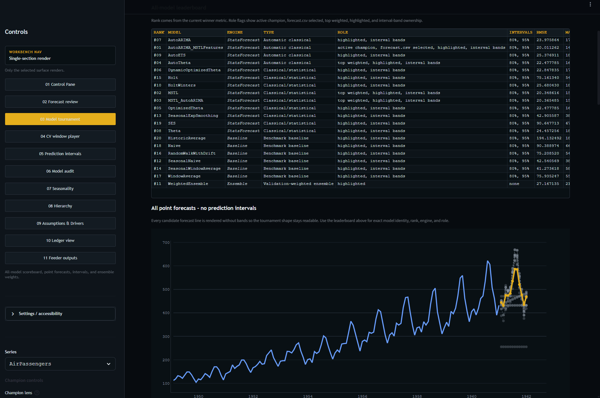
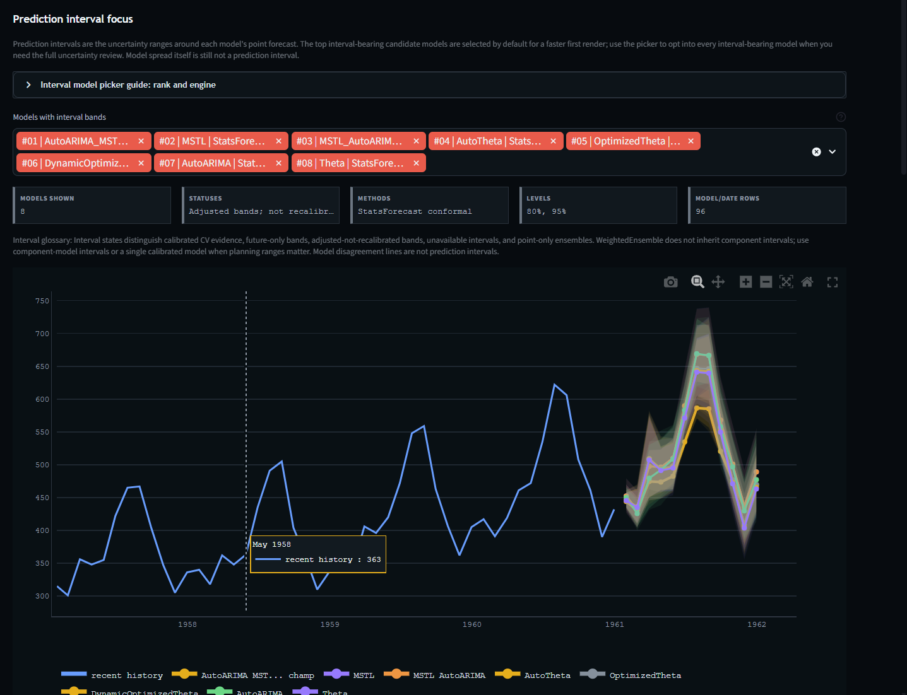
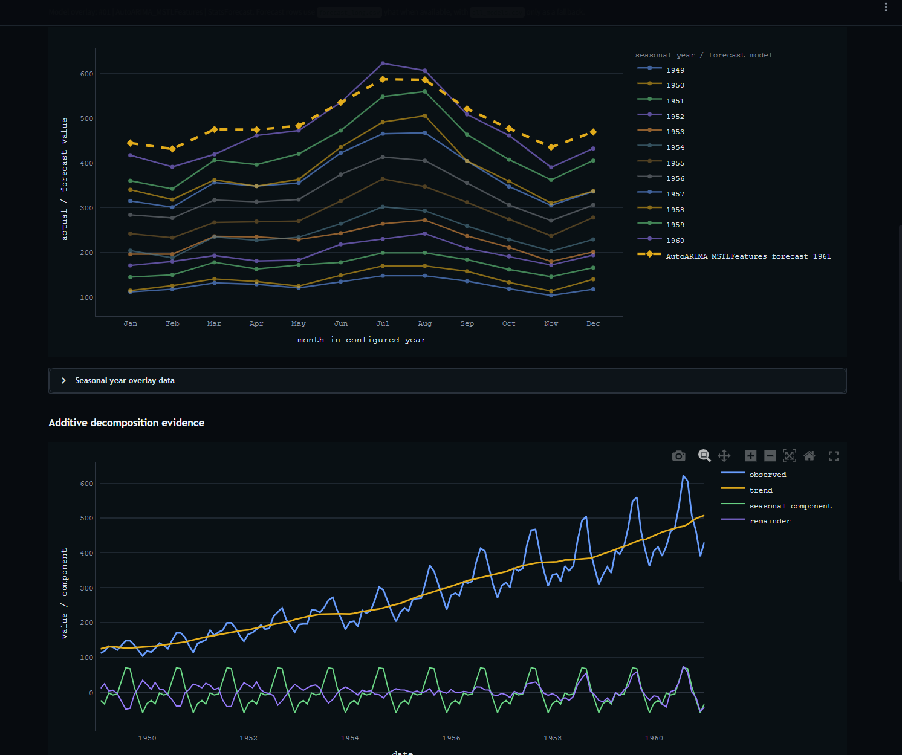
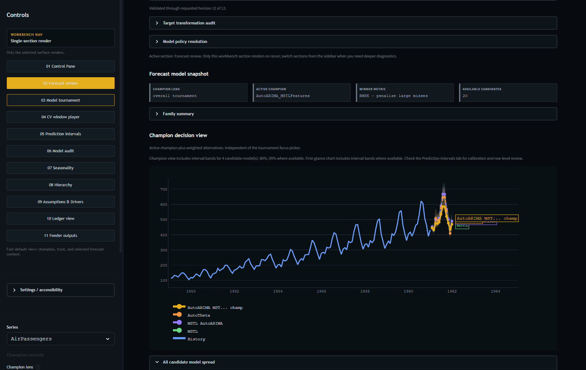
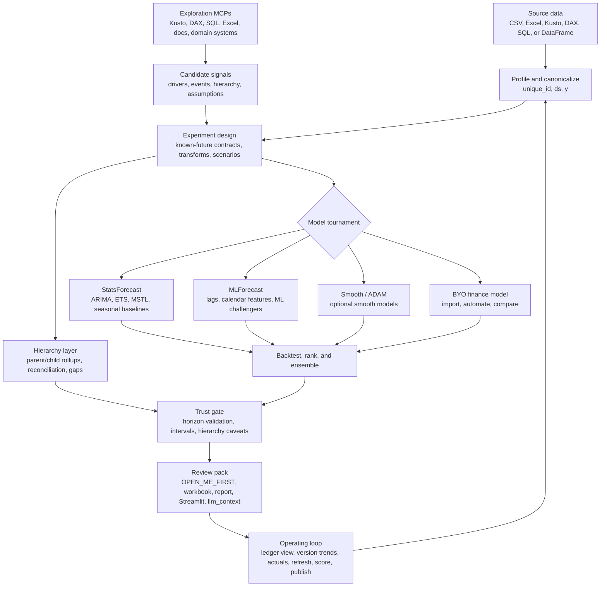

# nixtla-scaffold

[](https://pypi.org/project/nixtla-scaffold/)

Simple, explainable Nixtla forecasting scaffolding for finance users and AI agents.

`nixtla-scaffold` turns a small time-series table into forecast outputs that are easy to review, explain, and hand to another analyst or agent. It is built for the messy middle between "quick model demo" and "finance-ready operating loop": profile the data, run sensible model candidates, expose the evidence, and package the results.

## Standalone engine, optional integrations

The Python package and `nixtla-scaffold` CLI are the product; Finn, agent skills and
the Copilot canvas are optional ways to use it. Native forecasting requires no
Finn account, R, Azure credentials, Copilot installation or Node runtime. Once
dependencies are installed, local native forecasting can run without network
access. The Python API works in scripts, notebooks and other applications.

The engine is MIT-licensed and distributable as a wheel, source archive or GitHub
checkout. See [Five-minute forecast](#five-minute-forecast) for installation.
To reproduce a checkout, use `uv sync --frozen`; optional model families have
their own dependencies and platform constraints. The bundled canvas is installed
explicitly on the destination machine and records that machine's Python path;
do not copy an existing `runtime.json` or virtual environment to another machine.
The canvas needs its supported host and Node; neither is needed by the engine.

Integration adapters translate external inputs and outputs; they must not make
the native engine depend on a particular workspace, ledger, account or reporting
pipeline. The Paper/Finn submission runner belongs to its consuming workspace,
not this package. Its narrower point-only policy does not replace the standalone
engine's model, ensemble, anomaly, interval or production-qualification features.

Share source, synthetic examples and distribution artifacts, not private datasets,
saved forecasts, local databases, credentials or installed runtime bindings.
Release gates reject known local-state/credential paths in distribution archives
and execute an installed-wheel native forecast outside the checkout with network
and optional host/runtime execution blocked. This is a packaging safeguard, not a
complete secret scan or authorization to publish business data. Windows, Linux
and macOS clean-install checks run in CI; optional engines remain separately tested.

## Forecast Workbench for Copilot

**The skill is the forecasting runtime contract; the canvas is its interface.**
The `nixtla-forecast` skill inspects supplied data first, chooses feasible native
models and bounded improvements, and asks only about consequential ambiguities
or new authorization. Unknown business context stays unknown and limits the
claim; it does not trigger a mandatory interview. Accuracy, leakage, horizon and
untouched-confirmation gates still apply.

New Python, CLI, pipeline and canvas requests default to **accuracy-first**:
a provisional six-period horizon, the standard native ladder, strict requested-
horizon evaluation and paired comparison. Explicit overrides are retained;
disabling pairing limits the planning claim. `--preset quick` is explicitly
exploratory and cannot produce a planning-ready claim, even with complete context.
The run intent and policy version are saved independently of business-context
completeness. Unknown context stays unknown.

For new dictionary-based requests use `resolve_forecast_spec`; use
`forecast_spec_from_dict` only to rehydrate saved recipes. Versionless manifests
retain legacy defaults rather than acquiring the new settings during refresh.
The manifest records the original-scale RMSE/MAE/bias scoring contract and the
within-run Naive guard (5% by default). This guard is distinct from the existing
cross-run promotion policy, which also requires paired and confirmation evidence.

The local accuracy stack is pinned to StatsForecast 2.1.1, MLForecast 1.1.0,
scikit-learn 1.7.2 and LightGBM 4.7.0. The ML packages are included in the base
installation; `[ml]` remains a compatibility extra. scikit-learn retains Python
3.10 compatibility. LightGBM candidates use one thread and recorded fixed seeds;
other process/thread settings are reported separately. Run manifests record
installed numerical-library versions, the observed runtime-source digest and
the lockfile hash. Wheels include that lockfile. These are provenance records,
not a certificate of accuracy or leakage-free execution.

### Production qualification and delivery

`--preset production` opts into a **fail-closed statistical release contract**,
separate from execution success and business/planning approval. It does not
upgrade old runs or replace the existing planning gate.

```powershell
nixtla-scaffold forecast --input data.csv --preset production --horizon 31 --freq D --season-length 7 --selection-objective monthly_landing --output runs\production-v1
```

The Python equivalent is `run_forecast(data, forecast_spec_preset("production", ...))`.
Pipelines use `forecast.preset: production`; refresh retains the full saved policy.
The verified ConformalForecast backend is required; it is never installed silently.

- The default schedule requests 32 **disjoint full-horizon origins**. Three warm
  up model selection; 20 subsequent policy-error windows warm up calibration;
  at least five later windows must remain for assessment. Short history cannot
  manufacture this support by overlapping or shortening windows.
- At every origin, selection uses only fully landed prior outcomes, the declared
  objective, Naive guard and origin-local configuration screen. The final forecast
  uses this same selector. Native fitting remains with Nixtla.
- The contract defaults to <=10% error (monthly Landing MAPE, or daily/period WAPE
  for the RMSE objective), <=5% absolute signed bias, and no worse primary loss
  than either required Naive/SeasonalNaive reference on the identical assessment
  cohort. These are visible provisional runtime limits, **not an approved SLA**.
- 80%/95% bands are calibrated on the **selector's own errors**, including model
  switches. Later coverage must be within five percentage points of nominal and
  interval scores must be no worse than the matching calibrated benchmarks.
  These are marginal horizon bands, not summed monthly-total or simultaneous bands.
- `ProductionPolicy(ensemble_members=("AutoETS", "Ridge"))` adds a frozen equal
  blend to that same replay. Missing members are not silently reweighted. Existing
  adaptive/greedy ensemble workflows remain available outside production v1;
  their component evidence does not automatically qualify them for release.

Every series must pass; pooled averages cannot hide a failing series.
`production_readiness.json` contains thresholds, measurements and exact failures;
`audit\production_backtest.csv`, `production_decisions.json` and
`production_calibration.json` retain the cutoff-level evidence. Component rankings
in the ordinary audit reports are not the deployed-policy assessment score.
Publication timing is honored when provided; otherwise the timestamp assumption,
snapshot/revision limitation and residual-exchangeability assumption stay explicit.
Historical qualification never becomes untouched confirmation.

On success, `to_directory` atomically creates `release\` containing the forecast,
qualification, a readable summary, resolved spec, runtime/data provenance and SHA256 checksums verified by operational receipts. **This
is the delivery bundle**; ordinary reports remain diagnostic/planning artifacts.
On failure, diagnostics are saved but no release is created; Python raises
`ProductionReleaseError`, `forecast`/`refresh` return exit code 2, and pipelines
record `quality_rejected`. Production outputs must be new or empty directories,
so a rejected refresh cannot overwrite a previous release.

Anomaly adjustment is a **matched challenger**, not unconditional data cleaning.
`analyze` already prioritizes an adjustment trial when conservative anomaly guards
find eligible transients, within its two-improvement budget. To isolate it:
`experiment --variants anomaly_adjustment --max-variants 1 --hypothesis "..."`
adds an unchanged control automatically. Detection/adjustment is recomputed within
each training cutoff; actuals and scoring targets remain unchanged.
Production experiments score the deployed policy's later assessment cohort and
save qualification failures as evidence, not as failed model execution.
They always use diagnostic-only persistence (`to_directory(..., release=False)`):
even a qualifying trial creates no delivery bundle and never adopts itself.

Production v1 intentionally rejects scenario adjustments, hierarchy reconciliation,
external/custom models, normalization and business-driver paths until their exact
deployed policies are supported. It does not fabricate missing business context,
grant approval, publish externally or guarantee future accuracy.

### One analyst workflow, with reusable computations

`analyze` is the high-level workflow shared by Python, CLI and the workbench.
It profiles the supplied source, saves one baseline and freezes at most two
retrospective diagnostic or ensemble experiments. It never adopts a result. `run_forecast`
and `forecast` remain the lower-level, single-run interfaces.

```python
from nixtla_scaffold import analyze, ForecastSpec, EvaluationPolicy

job = analyze(
    "data.csv",
    ForecastSpec(horizon=28, freq="D",
                 evaluation=EvaluationPolicy(cache_directory="runs/cache")),
    workspace="runs/analysis",
    max_wall_clock_seconds=900,
    improvement_policy="greedy",  # optional; replaces the second experiment
)
```

```powershell
nixtla-scaffold analyze --input data.csv --horizon 28 --workspace runs\analysis --improvement-policy greedy
nixtla-scaffold analyze --workspace runs\analysis --resume-job <stopped-job-id>
```

Use `--spec-file` for the full saved settings, including any explicit repair,
calendar, objective and cache configuration. A smaller `--max-seconds` applies
to the whole initial budget; profiling and owned model workers are preemptible.
Python accepts a `threading.Event` as `cancel_event`. Resume reuses the immutable
baseline and frozen plan under the remaining original budget, and refuses changed
sources/runtimes. Quick mode skips improvements. Unknown context remains unknown.
The persistent catalog is usable without installing or opening the canvas.

The opt-in `EvaluationPolicy.cache_directory` cache stores exact native
origin/cohort results, including coherent shared ML preprocessing, in transactional
SQLite. Input values/availability, profile, features, transforms, model settings,
horizon, runtime/source identity and interval configuration bind the key.
Concurrent identical misses fit once. Float values round-trip without truncation;
no pickle or executable objects are loaded. Live payload storage defaults to
256 MiB and evicts oldest entries; oversized units are explicitly uncached.
Corruption fails explicitly. External/custom/driver inputs bypass this first
cache version. Scores, residual calibration, exposure checks and approval always
execute again; a cache hit is never confirmation or permission to adopt.
For scoped cleanup or recovery from corruption, stop jobs using that cache and
remove only `<cache_directory>\native_predictions.sqlite`. The next run rebuilds
it; do not remove source snapshots, saved runs or confirmation records.

`BlendRecipe(policy="greedy", members=(...), objective="daily_rmse")` and
`objective="monthly_landing"` are version-2 **experimental, opt-in** recipes.
They optimize the composed path with at most 32 deterministic greedy additions,
nonnegative normalized weights, and at least three complete, observable prior
origins. Monthly learning uses the same full-calendar landing objective as the
finance scorer, not individual daily RMSE. Clipping is component-first when
enabled. Later comparisons include equal weights, prior-selected best single
and global greedy on identical finite rows. Missing later support cannot win.

Horizon-group blending was evaluated with three predeclared lead-time bands,
shrunk toward the global recipe, and a joint monthly-path objective. It lost to
global greedy on all eight development tasks, so it is **not admitted to analyst
jobs or protected deployment**. The reproducible benchmark retains the prototype;
the canvas marks it unavailable rather than presenting an unearned feature.
Greedy itself remains an opt-in challenger, not a changed default or an automatic
promotion. Protected confirmation recalibrates the exact
deployed blend residuals rather than averaging component bounds.

Run the frozen eight-task synthetic comparison with
`python tools\feature_benchmark.py --output <new-directory>`.
It records native/matched parity, a cold shared workflow, cold/warm cache
ablations, objective/bias/secondary scores, exact paired support, runtime and
data fingerprints, fit counts, elapsed time and sampled peak process-tree RSS.
`--partition confirmation` consumes a separate fixed-seed final assessment once
per protocol in that output parent. This is an engineering benchmark, not proof
of superiority on business data; intervals are deliberately not requested here.
The reserved eight-task assessment preserved native numerical parity and used
zero native fits on identical warm repeats. Warm-repeat time fell 75.6-92.3%
(84.4% median task reduction), but cold-run overhead was variable and missed the
10% target on one task. Greedy improved the primary score on three of eight
tasks, including a 6.4% landing-error reduction, and regressed on the other five.
These synthetic results support optional computation reuse and experimentation,
not a new accuracy default or a claim of superiority to FINN.

### Runtime and calibration capabilities

`nixtla-scaffold runtime` returns a read-only JSON receipt for the selected
interpreter: import outcomes, dependency versions, source/lock fingerprints and
the 53 registered built-in recipes. `--python <explicit-interpreter>` inspects
another matching installation without selecting it for jobs. The workbench's
**Runtime capabilities** disclosure uses the same contract. Registered recipes,
importable dependencies, dataset eligibility and saved execution outcomes are
different facts; catalog entries never acquire tournament ranks or chart paths.
Import probes run concurrently with a 30-second per-engine limit, install nothing
and fit nothing. The service coalesces requests and caches successful status for
60 seconds; explicit refresh bypasses that cache. Job fingerprints now also
bind the Python interpreter and supported forecasting/numerical-library versions.
Existing saved results are not rewritten; runtime changes invalidate resumable
jobs rather than changing their environment silently.

Optional dependencies are pinned to Smooth 1.1.0 on Python 3.11+ (1.0.3 on
Python 3.10) and ConformalForecast 0.1.0. The lock uses
immutable official Git sources for ConformalForecast and its
UtilsForecast 0.2.17 dependency. Its source is declared on the `conformal` extra,
but the shared lock resolution also selects that Git pin for fresh base installs.
An older core environment retaining 0.2.16 is not that frozen lock. Windows AMD64
Python 3.12 uses the official Smooth wheel. Use a separate
environment, not the active forecasting interpreter:

```powershell
$env:UV_PROJECT_ENVIRONMENT = '.nixtla-workbench\runtime-lab'
uv sync --python 3.12 --frozen --extra smooth --extra conformal --extra dev
```

The earlier download blocker was resolved without disabling TLS verification.
Smooth 1.2.0 was evaluated but **not adopted**: a 15-case, three-recipe fixture
matrix produced 6 successful cases on 1.1.0 versus 5 on 1.2.0. The newer version
regressed short-series CCC (`float.rename`). Constant/all-zero inputs and
CustomPool remain explicitly unsupported in the tested matrix; positive and
intermittent CCC/ZXZ cases passed. These small fixtures establish compatibility,
not accuracy. All-model failures retain their reasons and nonfinite forecasts
are rejected.

CustomPool is quarantined before calling upstream AutoADAM; constant/all-zero
input is rejected before CCC/ZXZ fitting. Failed recipes never acquire a
substitute model's label. HierarchicalForecast is separately disclosed as an
optional reconciliation adapter, not another point-model family.

NeuralForecast and Torch are intentionally excluded: the supported focus is
statistical forecasting, tabular ML, Smooth and conformal intervals without the
deep-learning dependency stack. The generic custom-model adapter remains available
for separately approved integrations. Existing saved forecasts and evidence are
not rewritten.

`--interval-backend split_conformal` or `--interval-backend nexcp` enables the
genuine optional ConformalForecast implementation. `native` remains the default.
Both experimental methods are compared on identical eligible rows, with coverage,
width, Winkler interval score and WIS recorded by series, level, horizon and
origin. Calibration accepts only fully landed, nonoverlapping horizon windows;
overlapping origins cannot multiply the effective residual sample. Cold starts
and unsupported confidence levels remain point-only with a reason, rather than
receiving a substituted band. NexCP's effective-sample guard can reject 95% when
SplitConformal supports it. Configurations and replayable residual state are
persisted; points and model selection are unchanged.

Interval comparison rows record `scoring_version=2` and
`aggregation=observation_mean`: overall and horizon Winkler scores weight every
matched observation equally, including unequal-length cutoff windows. Earlier
unversioned aggregate Winkler scores used only the first cutoff and must be
rescored before comparison. The workbench hides those legacy aggregate scores;
window scores, coverage, width and WIS remain available. Original files and raw
exports are retained for audit, not silently rewritten.

Exact frozen-blend replay uses the same backend, never averaged component bounds.
Protected confirmation still reserves 20 calibration windows and a later
confirmation. Refresh recalibrates the unchanged blend on the new snapshot's
retrospective replay; it does not reuse old confirmation or old calibration state.
These experimental marginal intervals cannot certify monthly aggregate coverage
or planning readiness. Target-date availability is labeled uncertified unless
actual release times are supplied.

The Forecast and Models views show read-only saved interval evidence. Portable
outputs include `audit/interval_calibration.json`,
`appendix/interval_comparison.csv` and `appendix/interval_support.csv` with support,
age and cold-start reasons. Viewing or reloading these files never fits a model.

`--date-features-as-dummies` opts into MLForecast 1.1.0's one-hot calendar
encoding, also available as `FeatureRecipeSpec(date_features_as_dummies=True)`.
It reaches final fits, rolling-origin fits and point-only interval fallbacks,
and is recorded in candidate evidence. Default and historical recipes remain
unchanged. Evaluate it against the same learner, lags and origins; enabling it
does not prove an accuracy improvement. Horizon-specific exogenous features,
event lookups and pooled transforms are not enabled by this flag.

Additional default-off `FeatureRecipeSpec` fields expose native MLForecast
capabilities: `mlforecast_strategy="direct"`, `horizon_features`,
`lookup_lag_columns`, `pooled_rolling_window`, `pooled_partition_columns` and
`pooled_series_ids`. Matching CLI flags support saved specs and refresh overrides.
Horizon-specific features and LookupLag require direct models; recursive lookup
would otherwise risk treating predictions as observed event outcomes. External
columns require explicitly enabled regressor training, a hashed snapshot and an
as-of-safe calendar/contracted/scheduled `DriverSourceContract`. Unknown buckets,
unavailable releases and historical-only drivers are not silently admitted.
Pooling requires the exact declared cohort, common calendar and explicit
consistent target units. A partitioned rolling window counts calendar periods,
not matching-bucket occurrences: choose sufficient warmup or expect an explicit
fit failure. All guards apply anew at historical origins.

Candidate evidence records the actual input schema, advanced recipe, external
inputs and direct per-horizon estimator structures. `candidate_fits.csv` includes
input-schema column counts and successful fit/predict attempt wall time. A ladder
attempt's time is shared across its models, not a per-estimator benchmark, and is
excluded from recipe identity.

Direct-model explainability includes the one-based `horizon_step` and that
estimator's actual feature schema; coefficient/schema mismatches fail explicitly.
Automatic ML research can propose one calendar-dummy or bounded (2-28 step)
direct-horizon treatment without silently widening the family allowlist.
PCA, feature-selection and named-recipe flags that are only metadata are labeled
`recorded_intent` / `not_executed` in feature-selection receipts.

### Finance selection and total uncertainty

`--selection-objective monthly_landing` opts daily **flows** into a common native,
research and exact frozen-blend scorecard. Selection minimizes mean absolute
month-landing percentage error, with Next28 MAPE, date-averaged WMAPE and stable
model name as tie-breakers. The existing Naive practical-improvement guard still
applies. Default and saved historical daily RMSE policies do not change.

Each landing combines actuals known through its origin with predictions through
the current/next calendar month end. Only completely observed, horizon-covered
windows are scored. A period already closed at the origin is not a forecast.
`--clip-negative-points` floors each prediction before averaging or summing;
actuals are never floored. Missing predictions cannot shrink a candidate's
comparison cohort; a zero actual total makes percentage error undefined.
Windows, bias, worst error, Next28 and daily errors are saved as
`appendix/finance_scorecard.csv` and `appendix/finance_windows.csv`, and exposed
read-only in Forecast and Models. Calendar quarters mean Q-DEC, not an inferred
fiscal convention.

`--aggregate-intervals` independently opts into **experimental** month/quarter
bands calibrated from whole-total residuals, never summed daily bounds. At least
20 disjoint fully landed forecast segments must match period length, remaining
days and current/next offset. Calibration uses the finite-sample order statistic.
Insufficient support produces an explicit unavailable row. Exchangeability is
assumed, not proven; these are not simultaneous bands or planning certification.
Dynamic weighted ensembles are excluded; exact frozen-blend replay has its own
evidence path. Scenario-event and reconciled paths are rejected rather than
calibrating the wrong forecast. See `appendix/aggregate_intervals.csv` and
`audit/aggregate_interval_support.json`. Enabling this evidence does not change
point predictions.

Release CI has frozen core and optional-engine lanes plus frontend unit, service,
browser and bundle checks. Required optional tests fail on skips; the published
bundle comes from the verified frontend artifact. Clean-wheel smoke tests restore
dependencies from `uv.lock`, then install the wheel with `--no-deps` outside the
checkout. Exported registry hashes are verified; Git sources retain immutable
commit IDs (Git requirements do not support pip's hash-only mode).
`tools/runtime_benchmark.py --output <new-directory>` creates a synthetic
13-origin, 81-day acceptance fixture and timing receipt with an aggregate-on/off
point-invariance control; it is not a business accuracy benchmark. Invoke it with
the selected runtime under a bounded process deadline.

Accuracy-first runs use a frozen rolling-origin calendar, up to 24 origins by
default, with one-period spacing. Where feasible, the earliest training window
contains two seasonal cycles. Shorter histories use a disclosed smaller reference
window (at least four training observations by default) and limited evidence.
If the requested holdout cannot fit after that minimum, the runtime still returns
a finite directional baseline without claiming backtest validation. Historical
versionless recipes retain their earlier evaluation rule, including one-point
diagnostics from three observations; those are not upgraded to planning evidence.
`EvaluationPolicy` controls spacing, the origin cap
and an optional rolling training window; the same window rule applies to
historical fits and the final refit. Each origin fits its own models using only
available training rows. Repairs are performed within that prefix, and imputed
holdout values are never substituted for observed targets. New runs save
`appendix/observed_history.csv` separately from the repaired plotting history.

The component tournament requires complete support on its frozen schedule.
Missing hard periods disqualify a candidate rather than shrinking the reference
cohort. Learned-ensemble warmup is reported separately, not allowed to erase
component evidence. Overlapping origins are counted separately from disjoint
windows and are not independent confirmation. Ordinary forecasts remain
retrospective; timestamps do not certify historical publication vintages.
CLI and Python target profiling and fitting record hashed series/period keys in
the local `.nixtla-evidence` SQLite ledger. Research reserves confirmation before
diagnostics and consumes it once before scoring; restarts, renamed inputs and
revised target values cannot make those recorded periods untouched again.
The scope is the current workspace, overridable with
`NIXTLA_EVIDENCE_DIRECTORY` or `EvaluationPolicy.evidence_directory`. It is not a
global data-access certificate. Use target-specific series IDs within a scope.
Set `known_target_exposure="exposed"` when earlier exposure is known outside the
ledger (CLI: `--known-target-exposure`); such research remains retrospective.
The CLI also accepts `--evidence-directory`. Do not change scopes to re-label
known exposure. Interrupted consumed confirmation cannot be rerun as fresh.
Horizon-readiness checks use disjoint full-horizon windows, not the larger
overlapping-origin count. Missing or duplicate forecast keys and undefined
series metrics cannot disappear from research comparisons. Adopted versions
retain the parent's observed-history snapshot separately from repaired values.

Contracted driver inputs use **materialized, explicitly granted local CSV
snapshots**, not a new query server. `DriverSnapshotGrant` binds a source ID,
absolute CSV path, SHA256 and allowed text series IDs. A regressor's
`DriverSourceContract` declares entity/time/value keys, frequency, units,
stock/flow/rate semantics, release time, vintage, observation-period end, query
reference and mechanism. Supply grants in `ForecastSpec.driver_snapshots` or
repeat `--driver-snapshot` with the equivalent JSON. These are caller-supplied
authorization records; connected tools or data-file contents cannot grant access.

Every historical and final fit reconstructs the latest revision published by
that series' origin. Historical-only signals also require a completed observation
period and any declared release latency. No implicit aggregation, many-to-many
join, cross-series broadcast, unit mixing or changed snapshot is accepted.
`historical_lags` can freeze explicit lag periods; each must span the full
requested horizon, and its future feature values must actually be available.
Snapshot identity and selected vintages are retained in candidate execution
evidence and driver audit tables. Declared publication metadata is not a
provider-certified vintage history. Forecasted drivers remain blocked until a
paired upstream/downstream forecasting path exists; realized future values are
not a substitute. Existing uncontracted regressor declarations retain their
legacy audit path, not the stronger snapshot evidence.

Driver discovery retains a complete bounded search ledger, not just promising
cards: signed levels, changes, detrended/deseasonalized residuals, safe lead/lag
direction, temporal stability and approximate dependence-adjusted Bonferroni
tests. Analysis is within series, never a pooled size correlation. Affine/shifted
target proxies are rejected, and association cannot admit a feature or establish
causality. Optional screening beyond 100,000 rows or 50 series records an explicit
scope limitation without sampling or preventing a useful baseline. Research must
reserve the later target tail before screening its tuning partition.

The optimizer tests one contracted historical driver and frozen safe lag at a
time with a matched installed learner. Both the deployed path and fixed-learner
ablation must improve; unrelated recipe changes, missing origins, unstable
features, insufficient bias/secondary evidence and ties block recommendation.
Feature selection remains inner tuning, followed by exact frozen-spec later
confirmation. Explicit baseline/statistical-only policies are never upgraded to
ML as a side effect. Forecasted/future/scenario drivers are not certified by this
automatic lag-research path.

Referenced snapshots are copied into `driver_sources` with their SHA256. CLI,
pipeline and canvas refresh bind those immutable copies and preserve the recipe;
changed data requires an explicit new grant. Canvas research adds an unadopted
tuning-baseline version with its indexed source/search/failed-hypothesis/ablation/
confirmation/stop trail. `driver_refresh_monitor.json` records availability,
recipe/hash drift and landed ML errors versus Naive; it does not reconfirm the
feature's incremental effect or automatically replace a forecast.

After an approved package/skill update, synchronize the actual installed skill
using the matching runtime, not just an extension reload:

```powershell
nixtla-scaffold skill sync --yes
nixtla-scaffold skill check
```

Sync preserves a backup and records the matching Python interpreter in the
installed skill manifest. A local unreleased skill must use its matching runtime,
not an older public package. The same analyst-first contract applies without the
canvas through CLI/API workflows.

The new Copilot canvas replaces the questionnaire-first workflow with source
inspection, a bounded local forecast, and an evidence-led comparison workspace.
It uses a project explorer, recoverable independent tabs, light/dark themes,
interactive charts, exact-value tables and a contextual handoff to the existing
Copilot conversation.

**The primary Copilot experience:** inspect data, run bounded native models,
replay paired model/ensemble evidence, adopt a frozen recipe and refresh it as a
new version. Independent tabs retain their scopes and drafts. An unambiguous
source with an explicit horizon needs no intake questions. Opening the canvas
never starts a model or provider query.

- **SQLite file explorer:** browse every saved forecast family, version, source
  snapshot, note and job in the selected workspace. Expand a version into its
  original artifact folders; search the whole catalog, not just the loaded page.
  Folder expansion and independent file/data tabs persist across reloads. CSVs
  open as paged exact-value tables; text and scripts open read-only. Source
  previews preserve the saved tuning boundary and never reveal reserved targets.
  Use **Import an existing run** for outputs created outside this library; the
  explorer does not scan unrelated folders or read the FINN catalog.
- **Explore data:** open this tab on a saved forecast, source or CSV file. Select
  fields, filter rows, group up to three row dimensions, split by a column and
  calculate sum, average, min/max or counts. **Run query** evaluates the entire
  matching snapshot before paging; **Export full result** saves every result row,
  not just the preview. Name a query to save it in SQLite, reopen it from
  **Saved queries**, update it with conflict protection or save a copy. Each
  export includes a portable JSON query/provenance receipt, not warehouse SQL.
  CSVs retain numeric precision and missing values; protected observations stay
  withheld. Browser downloads support up to 4 MiB; larger complete exports use
  the displayed local paths. Tables over 32 MiB, 250,000 rows or 2 million cells,
  and pivots over 60 columns or 100,000 cells, fail explicitly rather than sample.
  No model or provider execution occurs.
- **Ensembles:** equal, fixed, inverse-error, top-k and family-diverse recipes.
  Diagnosis-led suggestions explain why a policy is worth testing. Weights use
  earlier observable outcomes; comparison lines share finite series/origin/period
  support. New native canvas tournaments also use paired support.
- **Analytical review:** Forecast distinguishes the saved selected output from
  candidate previews and provides a wide actual/forecast/interval copy-paste
  table. Measurements display two decimals, with original/thousand/million/billion
  unit controls; raw copy and scoped CSV exports retain original precision.
  **Forecast → Chart view → Seasonality** overlays periods from the saved run:
  daily data compares Monday-aligned months (or calendar day of month), monthly
  data compares years by month with an explicit year start, weekly data uses ISO
  weeks including week 53, and calendar-quarter data uses quarter positions.
  It defaults to the first forecast month/year and its two prior periods.
  Change the focus period or compare up to 12 periods; actuals are solid and
  forecasts are dashed, with original dates in tooltips and an exact-value table.
  Absent dates, nulls and out-of-horizon dates stay blank. Observed-only history
  is preferred; older versions explicitly disclose their saved-history fallback.
  The same view is in **Diagnostics → Seasonality**. This is a display projection,
  not a new source query, adjustment, resampling or evidence of accuracy. Unsupported
  frequencies retain the timeline; saved intervals are shown only on the timeline.
  **Models** exposes the complete saved leaderboard, family/metric/model lenses,
  an RMSE-versus-MAE Pareto frontier and all-model forecast race with a solid
  saved-actuals trend and an observed-history boundary. Model filters never
  remove the historical context. **Backtests**
  provides previous/next window navigation, explicit observed/evaluated dates,
  a gray forecast region, a fixed full-date axis and complete loaded actuals
  trend across window changes, saved candidate
  bands, error over origins and paged long-form predictions. Complete bounded
  backtests switch windows locally; larger reads keep the previous chart visible
  until the replacement is ready. The optional value-scale lock affects only
  the Y axis; the X axis never follows the selected window. Chart instances
  are updated rather than rebuilt.
- **Adjust:** choose any complete saved model path rather than being locked to
  the winner. The ordered worksheet is **chosen model -> optional calendar
  layer -> final tweaks -> saved version**. The calendar layer supports month
  length, weighted weekends, dated holidays and explicit monthly
  weekday-equivalent holiday losses. A monthly loss replaces the dated holiday
  effect, never adds to it. It multiplies the chosen path by relative effective
  activity days; by default it rephases to the same model horizon total, with an
  exact final rounding reconciliation. Turn off "Hold model horizon total" to
  allow the layer to change the total. Actuals remain unchanged. This retains
  model variation rather than replacing it with FINN's independent constant-growth
  scenario; no illustrative growth or holiday assumptions are silently copied.
  Adding exposure to ARIMA/MSTL can double-count existing seasonality, so the
  layer is default-off, explicit judgment and limited to complete monthly flows.
  Weekdays have weight 1; weekend and holiday weights default to 1, with the
  holiday calendar set to none. Equal weights still reflect month length.
  Edit the assumptions, then select "Update calendar layer" before finalizing.
  Stale or invalid calendar inputs block saving and export.
  Apply signed percentage/absolute changes across a period range,
  edit individual periods or override final values in a spreadsheet-style grid,
  and see horizon totals, running deltas and the live model comparison. A 10%
  haircut is `-10`; absolute changes use original units **per period**, after
  percentage changes. Percentages apply to the calendar-layer output when
  enabled, otherwise the model. Row inputs replace bulk inputs; final overrides win.
  Save a named, reasoned, immutable judgment version or branch a prior version.
  The saved version freezes the chosen model, inputs, calendar assumptions,
  dates, intermediate values and stage deltas with source hashes.
  Adjusted values flow into saved forecasts, Explore data, comparisons, exports
  and the ledger without changing source runs. Upload CSV or paste Excel cells
  with `ds,percent,amount,override,note` headers (up to 128 KiB); import clears bulk changes to
  avoid double application. Exports include the full comparison and JSON recipe.
  **Pipeline** leads with chosen-model, after-calendar and final values plus
  calendar, final-tweak and total changes. Calendar day counts and the factor
  bridge are in a separate disclosure; both tables keep the period column
  visible during horizontal scrolling. Final judgment summaries show nonzero
  bulk percentages and absolute changes in original units per period, their
  period scope and the row-input count when present; neutral settings read
  "No final changes." Inspect any stage or expand the complete recipe and
  source hashes. This is the saved pipeline, not unsaved worksheet edits.
  "Replay saved recipe" verifies the pinned original source and every
  comparison value without fitting or creating a version. Reopening the
  worksheet branches from that original model, not from already-adjusted values.
  Replay requires the original baseline to remain available. Judgment does not
  inherit baseline backtests/intervals or planning approval, and saving does not
  create an official lock. Replay never rebases onto refreshed data; for new actuals,
  refresh the model first and explicitly create a new adjustment version.
  Dated overrides are never automatically rolled forward. One selected
  series and up to 500 future periods per worksheet.
- **Diagnostics:** interval width and empirical coverage, residual time/horizon/
  distribution/one-step-autocorrelation views, frequency-aware seasonal overlays and saved
  seasonal decomposition. **Diagnostics → Seasonality → Calendar adjustment**
  breaks out month length, weekdays, weekends and holidays. Select the reference
  actual month, explicit holiday calendar (none, US federal observed or custom
  dates) and relative day weights. Holidays replace the ordinary weekday/weekend
  weight without double-counting. View normalized history, the factor bridge and
  a separate constant-rate calendar scenario alongside the untouched model
  forecast. "Use these assumptions in Adjust" transfers the weights and holiday
  calendar into the chosen-model layer, not this separate constant-rate projection.
  Assumptions persist; CSV/JSON exports retain the full calculation
  and provenance. Monthly flows only: these weights are assumptions, not learned
  effects, and the scenario is neither a refit nor planning approval.
  Hierarchy, drivers, scenarios, feature importance,
  FINN/BYO and all feeder tables have scoped, chartable evidence explorers with
  receipts and full-scope exports. The ledger exposes vintages, revisions,
  performance, adjustments, corrected actuals, regimes and locks.
  Views do not fit models, query providers or change selection.
- **Selection integrity:** selected points and saved model intervals are delivered
  unchanged unless an explicit scenario or reconciliation is requested. There is
  no automatic post-selection shrinkage based on the losing models' residuals.
  Exact score ties are disclosed and resolved deterministically, not presented
  as evidence that one tied model is superior. Missing winner metadata stays
  missing rather than being filled from another candidate. Raw and transformed
  lanes score the exact canonical actuals, not engine-rounded copies. Paired
  comparisons disclose lost rows/origins and each model's missing coverage;
  ensemble warmup is not counted as additional validation.
  Native MASE/RMSSE use a fixed training-only reference through each series'
  earliest supplied backtest cutoff, shared across models and origins. Exported
  diagnostics use the same denominators; later actuals cannot improve that scale.
- **Auditable candidate recipes:** new accuracy-first runs consider installed
  StatsForecast `AutoTBATS` and `AutoCES` when history supports them, plus
  damped/undamped additive-trend recipes when training data shows a trend.
  Explicit allowlists and historical policies retain their meaning. Each origin
  records constructor settings, actual fitted structure where available, failures,
  transformations and training-window context in `audit/candidate_evidence.json`.
  `audit/candidate_fits.csv` provides a paged per-origin review. Automatic ML uses
  regularized learners below 48 lagged training rows (with shallow LightGBM from
  24 rows); explicit allowlists remain explicit experiments, not accuracy claims.
  Automatic exclusions retain structured ineligible recipes instead of
  disappearing from the candidate record.
  A native TBATS implementation is not an exact
  reproduction of FINN's R TBATS fit; compare matched cutoffs before ranking them.
- **Honest uncertainty:** actual execution determines whether bands are native,
  conformal or unavailable. AutoTBATS is not mislabeled conformal. Saved receipts
  include calibration dates, observed sample counts and residual identities.
  New requests allow up to 20 feasible calibration windows without reducing ML
  lags solely to increase that count. Small samples, unsupported calibration and
  insufficient disjoint later evidence cannot earn a calibrated badge. Coverage
  is reported alongside width and interval score; disjointness does not prove
  statistical independence. Reconciliation without a joint deployed-policy
  backtest remains directional even when component scores look strong.
- **Separate ensemble comparisons:** component scores retain the full frozen
  schedule. `appendix/ensemble_comparisons.json` recomputes the frozen component
  winner on exactly the blend's later rows. Missing later predictions remain a
  limitation, not an opportunity to remove difficult periods. Retrospective
  improvement does not authorize promotion or adoption.
- **Bounded continuation:** stopped native canvas forecasts can resume explicitly
  with only the original remaining time. Saved baselines and hypotheses are reused,
  not searched again. Changed source/runtime, exhausted or unverifiable legacy
  budgets, protected research and side-effecting operations cannot be replayed.
  `maxWallClockSeconds` can lower the service's 900-second ceiling. Admission and
  worker startup consume that same budget; cancellation retains partial receipts.
  Separate-cohort rows have no shared Pareto eligibility or leaderboard rank.
- **Frozen external features:** each historical fit must use the deployed
  external-feature columns. A missing historical plan cannot silently replace a
  driver model with a no-feature fit under the same alias. Unsupported origins
  remain unscored; driver CV receipts require the actual matching feature path.
- **Scoped report reuse:** exports reuse derived evidence tables only within one
  read-only report operation. A later run or changed evidence is recomputed;
  faster report generation does not reduce model breadth or validation origins.
- **Confirmation:** an explicitly prepared, unexposed source can reserve 20
  calibration windows and one later confirmation window. Blend-specific residual
  intervals never average component bounds. Previously exposed observations are
  rejected, including renamed or revised overlapping sources.
- **Maintenance:** append actuals vintages, inspect forecast-versus-actuals,
  refresh the full saved spec, retain an adopted blend's recipe, and deliberately
  lock only a version whose saved claim gate permits it. Judgment versions
  support **Record landed actuals**, not direct judgment refresh. Use **Open
  original baseline to refresh**, refresh that model separately, then explicitly
  create a new adjustment version. Recording actuals updates ledger comparisons,
  not the saved forecast or its original historical inputs.
- **Pipelines and model depth:** review hash-pinned Python extracts/query files
  and optional transforms, or import existing pipeline YAML. Advanced settings
  preserve native hierarchy, transformations, drivers and installed model families.
  Custom Python entrypoints and optional FINN/finnts challengers have a separate
  execution approval. External/BYO CSVs have their own comparison and historical
  cutoff-scoring lane.

**Evidence boundaries:** retrospective adoption is directional, not promotion or
planning approval. Confirmation is workspace-scoped, not a global certificate of
untouched data; one final origin provides limited coverage evidence. Complex
scenario/reconciled/normalized blends remain gated on full-path evidence. External
outputs never become automatic blend components or champions. Future-only outputs
remain scenarios. Native research, explicit CLI workflows and all portable outputs
remain available; Streamlit is the compatibility viewer, not the primary canvas.
Analytical charts are bounded previews (at most 2,000 scoped rows and 1 MiB per
read); omitted rows are explicitly reported, while tables page through all rows.
Some optional workflows use the chartable evidence explorer rather than a
one-for-one copy of Streamlit's bespoke layout. Missing artifacts are labeled
as absent evidence, never replaced with synthetic diagnostics. Annual month
overlays require monthly data; other frequencies retain their saved profiles
and decomposition. Formatting and new views do not make a directional forecast
planning-ready.

For a built package, install into an empty project extension directory:

```powershell
nixtla-scaffold workbench install --target .github\extensions\nixtla-workbench --yes
```

Reload Copilot extensions, then open **Forecast Workbench**
(`nixtla-forecast-workbench`). Installation uses the current Python executable;
keep that environment available. Managed updates back up the previous extension
outside the extension discovery directory and refuse locally modified files.
No cloud credentials or provider packages are installed.

The source checkout's extension is ready after:

```powershell
uv sync --python 3.12 --extra dev
npm --prefix .github\extensions\nixtla-workbench\ui ci
npm --prefix .github\extensions\nixtla-workbench\ui run build
uv run --python 3.12 python tools\build_workbench_bundle.py
```

The last command regenerates the deterministic package bundle, including bundled
dependency licenses, after UI, protocol or extension changes. The
[design contract](DESIGN.md) describes the workspace and its boundaries.

`npm --prefix .github\extensions\nixtla-workbench\ui run test:service`
exercises owned worker cancellation, graceful shutdown and killed-service recovery.
Recovery verifies PID plus creation time, stops only verified orphans, preserves
partial evidence and never replays work automatically. Jobs are capped at two
concurrent workers and 15 minutes each. Script approval is not sandboxing:
self-contained entrypoints run under the local account with installed packages.
Dependencies, sibling modules and credentials are not silently installed or copied.

## What it does

| Feature | Why it matters |
| --- | --- |
| **Fast forecast runs** | Start from a CSV or workbook with `unique_id`, `ds`, and `y`; single-series files can omit `unique_id`. |
| **Model tournament** | Runs simple baselines plus StatsForecast candidates by default, with optional MLForecast, smooth ADAM, hierarchy, custom challengers, BYO finance models, and advisory ensemble labs. |
| **Trust-first outputs** | Shows model evidence, interval status, horizon validation, caveats, and next actions instead of pretending every forecast is planning-ready. |
| **Finance-friendly review** | Writes a clean HTML landing page, Excel workbook, selected forecast CSV, model card, diagnostics, and Streamlit app. |
| **Accuracy research** | Use bounded source discovery to generate falsifiable hypotheses, reviewer-gate each experiment, and confirm only the best candidate on untouched later data. |
| **Hierarchy and reconciliation** | Forecast parent/child rollups, reconcile coherent totals, and surface gaps before planning use. |
| **Forecast operating loop** | Track versions, landed actuals, drift, and forecast trends over time in the ledger view. |
| **Optional FINN bridge** | Canonicalize, compare, and score FINN/finnts R outputs as advisory external forecasts without making R a default dependency. |
| **Agent handoff** | Produces `llm_context.json` for each run and ships a forecasting skill for AI agents. |

## Retained compatibility viewer

| Model tournament | Prediction intervals |
| --- | --- |
|  |  |
| **Seasonality** | **Forecast review** |
|  |  |

## Five-minute forecast

Install the CLI:

```powershell
uv tool install nixtla-scaffold
```

Run a profile and forecast:

```powershell
nixtla-scaffold profile --input examples\monthly_finance_csv\input.csv
nixtla-scaffold forecast --input examples\monthly_finance_csv\input.csv --preset standard --horizon 6 --levels 80 95 --output runs\demo
```

Open `runs\demo\OPEN_ME_FIRST.html` first. It points to the clean workbook, static report, selected forecast, Streamlit app, and LLM handoff packet.

## The mental model



Think of it as a forecast workbench, not a single model. Use the right MCP or query tool to explore source data and candidate regressors, turn only trusted known-future signals into experiments, let the tournament compare statistical, ML, smooth, hierarchy, and BYO finance-model paths, then use the ledger view to track forecast versions, trends, and actuals as the operating loop matures.

## Input shape

Use a long table:

| unique_id | ds | y |
| --- | --- | --- |
| Revenue | 2024-01-31 | 100000 |
| Revenue | 2024-02-29 | 104000 |

Finance exports can keep business column names:

```powershell
nixtla-scaffold forecast --input plan.xlsx --sheet Data --id-col Product --time-col Month --target-col Revenue --preset standard --horizon 6 --output runs\plan
```

## Presets

| Preset | Use when |
| --- | --- |
| `quick` | You need a fast exploratory read or smoke run; it is non-promotable. |
| `accuracy-first` | You want bounded context discovery, serious native candidates, full-horizon validation when feasible, explicit planning-readiness gates, and chronological promotion evidence. |
| `standard` | You need the normal serious finance forecast. |
| `strict` | The forecast feeds a high-stakes decision and should require stronger validation. |
| `hierarchy` | Parent and child planning totals need to tie. |

## Outputs to open first

| File | Use it for |
| --- | --- |
| `OPEN_ME_FIRST.html` | Clean landing page with the best next files. |
| `output\forecast_review.xlsx` | Compact workbook for analyst review. |
| `forecast.csv` | Selected forecast rows with horizon and interval guardrails. |
| `report.html` | Static review report with evidence and caveats. |
| `streamlit_app.py` | Interactive local dashboard. |
| `llm_context.json` | Single-file handoff packet for an LLM or agent. |
| `appendix\context_receipt.json` | Accuracy-first intake, source-discovery provenance, and candidate-driver dispositions. |
| `appendix\research_budget.json` | Selected hard research bounds plus known consumption and remaining budget. |
| `appendix\accuracy_gate.json` | Authoritative `planning_ready`, `directional_only`, or `blocked` claim decision with remediation. |
| `appendix\signal_needs.json` | Diagnosis-led information needs and whether source discovery is complete. |
| `appendix\signal_probe_ledger.jsonl` | Append-only bounded source probes with capability, query count, provenance, and result. |
| `appendix\signal_contracts.json` | Validated context/scenario/regressor/reject dispositions with grain, vintage, leakage, and future-value contracts. |
| `appendix\hierarchy_rollup.csv` | Parent/child rollup coverage and reconciliation gaps when hierarchy is enabled. |
| `appendix\ensemble_policy_receipts.csv` | Advisory ensemble policy receipts; extra ensemble artifacts are written when `--ensemble-policy` is requested. |
| `research_plan.json` | Optimizer budget, tuning/confirmation policy, hypothesis queue, and baseline contract. |
| `iteration_ledger.csv` | One row per attempted hypothesis with cost, evidence, reviewer status, and disposition. |
| `promotion_decision.json` | Advisory decision from exact tuning evidence and untouched confirmation; never mutates the official forecast. |
| `stop_receipt.json` | Why research stopped, budget consumed/remaining, best candidate, and unresolved evidence gaps. |
| `signal_experiment_dispositions.json` | Whether each admitted signal was queued, tested, blocked, or not applicable, with an explicit reason. |
| `.github\agents\finn-forecast-analyst.agent.md` | Repo-level Copilot custom-agent profile for FINN/scaffold review workflows. |

New runs already use accuracy-first defaults. Inspect the supplied source and
forecast with its known mappings and horizon; `setup` and context files are
optional scaffolding, not intake prerequisites. Use only authorized sources,
preserve unknown business context, and continue with an honest directional
baseline when technically possible. Incomplete context or validation evidence
prevents a planning-ready claim, not all useful analysis.

## Accuracy-first experiments

`experiment` tests one named hypothesis. `optimize` runs a bounded sequence of
evidence-led hypotheses and reserves the latest eligible horizon block(s) for
confirmation before any candidate is ranked.

```powershell
# Generate the queue from forecast evidence and the declared context budget.
nixtla-scaffold optimize --input data.csv --preset accuracy-first --context-file forecast_context.json --horizon 6 --output runs\accuracy_research

# Run one attributable transform hypothesis.
nixtla-scaffold experiment --input data.csv --preset accuracy-first --context-file forecast_context.json --horizon 6 --variants log1p_transform --hypothesis "Multiplicative growth should improve scale-free error without adding bias." --max-variants 1 --output runs\log1p_test
```

The baseline runs outside the research-iteration count. Each completed iteration
writes hypothesis, prediction, metric, decision, and four reviewer receipts. Tuning
uses exact paired cutoffs and equal-weight scale-free metrics across series. Only
the best native candidate reaches untouched confirmation; ties keep the simpler
baseline. FINN can run as an explicit bounded hypothesis, but external promotion
remains advisory and requires human approval. When FINN is enabled, the optimizer
reserves compute for the baseline plus the required FINN attempt before optional
hypotheses; an undersized compute budget fails before research starts. External
results are evaluated as one panel-wide source/scenario/model configuration rather
than a synthetic mix of different per-series winners.

Typed `signal_needs` must be complete, source-query-budget exhausted, unavailable,
or explicitly opted out before the optimizer starts generic catalog experiments.
Validated signal contracts seed attributable driver or scenario hypotheses only
when a matching executable declaration exists; otherwise the disposition artifact
records why the signal was not tested. Standalone explicit experiments automatically
run a matched baseline control. Baseline and treatment rankings require the same
`resolved_candidate_fingerprint`; optional-package or runtime drift suppresses
ranking until a new matched control is run. `all_models` is the explicit exception
where changing the candidate set is itself the named treatment.

## FINN-inspired options

FINN/finnts remains optional. The scaffold stays the canonical Python/Nixtla workbench, while FINN outputs can be imported as advisory external forecasts:

### One-command FINN challenger lane

The preferred integration is the spec-driven challenger lane: add `--finn` to a normal forecast (or a `challengers` block to the spec JSON) and the pipeline runs FINN automatically after the native tournament — env check, spec-generated R runner (no R authoring needed), run, compare, cutoff scoring, and a unified leaderboard:

```powershell
nixtla-scaffold forecast --input data.csv --horizon 6 --freq ME --season-length 12 `
  --finn --finn-models ets snaive --finn-back-test-scenarios 4 --output runs\demo
nixtla-scaffold finn pipeline --run runs\demo --models ets snaive   # retrofit an existing run
```

Spec form (round-trips through manifests, refresh, and pipelines):

```json
{"challengers": [{"engine": "finn", "enabled": true, "models": ["ets", "snaive"], "back_test_scenarios": 4, "on_error": "skip"}]}
```

Semantics:

- **Soft-fail by default** (`on_error: "skip"`): if R/finnts is missing or FINN errors, the native run still succeeds and `finn\challenger_status.json` records the skip/failure reason plus a remediation hint. Use `on_error: "fail"` to make challenger failures fatal.
- **Apples-to-apples**: FINN cutoff-labeled backtests are scored against the scaffold's own actuals and metric contract; `appendix\challenger_leaderboard.csv` merges native and challenger lanes with `lane`, `comparable`, and cutoff-coverage columns. Champion selection still ignores challenger rows.
- **Agent-friendly**: `finn\agent_brief.json` summarizes status, environment, comparable metrics, artifact paths, and suggested next commands; everything is registered in `manifest.json` and `llm_context.json`.

### Manual bridge (pre-produced FINN files)

Direct FINN execution needs a local R install with `Rscript` on `PATH` plus the `finnts` R package (common Windows install paths are auto-discovered). On Windows, install R first, restart your terminal, then run `nixtla-scaffold finn check`. The no-R path still works for generating the runner template and for ingesting/comparing/scoring FINN-shaped CSV outputs.

```powershell
nixtla-scaffold finn check
nixtla-scaffold finn run --input data.csv --output runs\finn_template
nixtla-scaffold finn ingest --input finn_forecast.csv --output runs\finn_ingest
nixtla-scaffold finn compare --run runs\demo --input finn_forecast.csv
nixtla-scaffold finn score --run runs\demo --actuals actuals.csv --input finn_backtest.csv --season-length 12 --horizon 6
```

When attached to a scaffold run, FINN artifacts land under `runs\demo\finn` and are picked up by the generated Streamlit dashboard, HTML report file guide, `manifest.json`, and `llm_context.json`. Treat `finn\external_model_metrics.csv` as the apples-to-apples evidence table; FINN remains advisory unless a human explicitly promotes or locks a version.

Native FINN/finnts usage is now mapped at the workflow level:

| FINN path | Core functions | How it should consolidate with this scaffold |
| --- | --- | --- |
| One-shot forecast | `forecast_time_series()` | Produces future forecast, backtest results, and best-model outputs that can be canonicalized into `finn\finn_forecasts.csv` and scored through the shared external-model scoring contract. |
| Staged run | `set_run_info()` -> `prep_data()` -> `prep_models()` -> `train_models()` -> `ensemble_models()` -> `final_models()` -> `get_forecast_data()` | Best fit for a deeper bridge because each stage maps to scaffold receipts: prep/data quality, model candidates, ensemble policy, final forecast, and backtest evidence. |
| Agent loop | `set_project_info()` -> `set_agent_info()` -> `iterate_forecast()` / `update_forecast()` / `ask_agent()` | FINN can run an R-native forecast agent with LLM objects; scaffold should ingest its artifacts, show agent answers in reporting, and still require shared cutoff scoring before greenlighting comparable model evidence. |

Important FINN knobs to preserve when bridging include `back_test_scenarios`, `back_test_spacing`, `forecast_approach`, `run_global_models`, `run_local_models`, `run_ensemble_models`, `average_models`, `max_model_average`, `recipes_to_run`, `models_to_run`, `models_not_to_run`, `feature_selection`, `external_regressors`, `clean_missing_values`, `clean_outliers`, `negative_forecast`, `parallel_processing`, and `inner_parallel`.

Native ensemble labs are also opt-in and do not change champion selection:

```powershell
nixtla-scaffold forecast --input data.csv --horizon 6 --ensemble-policy top_k_average --ensemble-policy family_diverse_average --output runs\ensemble_lab
```

Top-k and family-diverse membership and advisory-policy ranking honor
`--selection-objective`: daily RMSE by default, or Landing MAPE with Next28 MAPE
and daily WMAPE tie-breakers for `monthly_landing`. Monthly membership uses only
complete, already-observable prior origins; it never falls back to RMSE when
monthly evidence is unavailable. Receipts record the objective.

Full-history training is not automatically appropriate for changing seasonal
patterns. MFLES can use multiplicative seasonality internally even when no
external target transform is requested. Compare an explicit
`EvaluationPolicy(training_window=...)` on identical cutoffs when the recent seasonal mix changes;
do not cap a forecast or switch windows merely to obtain a preferred total.

### Configuration is evidence, not a black box

#### Calendar-aware anomaly review

New requests automatically inspect daily/business-daily training prefixes with
`AnomalySpec(mode="detect")`; old saved specs lacking this policy replay with it off.
The detector uses installed StatsForecast robust MSTL, a separate prior-weekday
endpoint check, and a 182-observation lookback independent of model training history.
Its conservative starting thresholds are a robust residual score of 6 and a 25%
relative deviation, with a 1% residual-scale floor. These are explicit heuristics,
not calibrated probabilities or universally optimal thresholds.

Only isolated transients are eligible for a modeling replacement. The latest week,
declared holidays and adjacent dates, episodes of three or more consecutive flagged
observations, repeated weekday/monthly deviations, phase-matched level changes, imputed
targets, points without two matching weekdays on either side, and treatments exceeding
3% of the review window are protected. Outages can be valid consumption observations:
no raw actual, month-to-date total, or test actual is rewritten. Detection and any
training adjustment are recomputed once per origin/cohort, before model fitting.

`AnomalySpec(mode="adjust")` (also `--clean-outliers` or `--anomaly-mode adjust`)
requires the shared rolling-origin engine. It resolves native interval requests to
outer `split_conformal` calibration; explicit NexCP is preserved. Inner intervals
based on cleaned holdouts are disabled. Insufficient raw residual support means
unavailable intervals, never narrower bands manufactured by cleaning.

`CalendarSpec(enabled=True)` / `--enhanced-calendar` enables native MLForecast
categorical month/weekday and month-boundary features. An explicit
`holiday_calendar="us_federal"` or `"custom"` adds holiday/before/after indicators.
Custom dates require `known_as_of`; dates unavailable at an origin are not admitted.
The default is **no holiday geography**, not US holidays. These are learned features,
not judgment multipliers applied again after prediction. Monthly support is recorded;
September weakness is a hypothesis, not a fixed discount or a 30-day season.

```python
from nixtla_scaffold import AnomalySpec, CalendarSpec, ForecastSpec, analyze

spec = ForecastSpec(
    horizon=31, freq="D",
    anomaly=AnomalySpec(mode="detect"),
    calendar=CalendarSpec(),  # no assumed holiday geography
)
job = analyze("daily.csv", spec, workspace="runs/calendar_review")
```

`analyze` now prioritizes an admissible anomaly-treatment trial and an enhanced
calendar trial when a native ML model ran, then fills remaining slots with existing
ensemble trials. The same **two-improvement / 900-second maximum** applies; explicit
greedy selection still replaces the second slot. Trials preserve the model-family
policy, freeze their specs, score matched original actuals, save separate unadopted
versions and `analysis_pair.json`/CSV, and never replace the baseline automatically.
Standalone `experiment --variants anomaly_adjustment` and `enhanced_calendar` are
also available; low-level `run_forecast` remains a single declared run.

Inspect `audit/anomalies.json`, `audit/anomaly_series.csv` and
`audit/anomaly_points.csv`, or **Diagnostics > Configuration > Calendar and anomaly
review**. The future review includes all inspected points; historical receipts retain
flagged points plus complete per-origin counts. Values are in saved reporting units
(normalized units when normalization is declared). Scores, proposed replacements,
decisions, as-of timestamps and modeling-only adjustment IDs remain auditable; these
are not approved actual revisions in the operational ledger.

Native fitted-model diagnostics are separate from that preprocessing policy.
The runtime reads supported StatsForecast estimators' `predict_in_sample(level=[99])`
after fitting, without another fit or any change to forecasts. This is the fitted-value
approach in Nixtla's [anomaly tutorial](https://nixtlaverse.nixtla.io/statsforecast/docs/tutorials/anomalydetection.html);
`plot_anomalies=True` is a plotting option, not automatic data correction.
`audit/native_fitted_points.csv` retains up to 182 final-training observations per
model, fitted values, native 99% fitted bounds and flags, converted back to reporting
units. `audit/native_fitted_summary.csv` retains bounded counts/statuses at every origin.
Unsupported adapters and missing intervals are explicit. Diagnostics > Configuration
shows these for the focused model, including candidates rejected from selection.
These are in-sample descriptions, not calibrated future bands, historical live alerts,
or probabilities that observations are erroneous. Training-copy adjustments remain
separate; actuals and scored targets never change.

Profiling now separates the **calendar prior** from measured seasonal evidence.
For example, `freq="D"` gives a seven-observation weekly prior; it does not prove
that weekly seasonality exists. Multipliers are respected (`2MS` means six
observations per annual cycle, `15min` means 96 per daily cycle); non-integral
cycles such as a week sampled every two days are not rounded into false periods.
The bounded CoreForecast detector is reported separately and never overrides an
explicit period. Complete-cycle shape diagnostics compare early and recent
blocks after normalizing each cycle by its own mean, rather than confusing
growth in level with growth in seasonal amplitude. These are descriptive
heuristics, not statistical significance tests.

New runs write `audit/configuration.json` and four companion CSVs for series,
seasonal periods, phase profiles and model settings. The workbench exposes them
under **Diagnostics > Configuration**, also reachable from **Models > Review
configuration**. It distinguishes supplied settings from actual fitted structure,
external from internal transformations, and native tuning loss from the outer
selection objective. Each rolling-origin fit retains its own training-only
diagnostic receipt. Old saved versions show an explicit unavailable state; they
are neither refit nor retrospectively certified.

| Setting | Scope |
| --- | --- |
| `season_length` | Primary period for single-season models, baselines and lag defaults; explicit values are retained. |
| `model_configuration.seasonal_periods` | Up to three explicit integer periods, in importance order, for MSTL, MSTL_AutoARIMA, MFLES, AutoMFLES and AutoTBATS. Other models retain the primary period. |
| `model_configuration.mfles_seasonality` | `auto` retains native behavior; `additive` and `multiplicative` are explicit treatments for MFLES/AutoMFLES. Multiplicative requires positive modeling targets. |
| `model_configuration.mfles_fourier_order` | Explicit order below half of every supplied seasonal period; `null` retains the native heuristic, which can contain redundant harmonics. |
| `model_configuration.automfles_test_size`, `automfles_windows`, `automfles_step_size` | Inner validation horizon, requested window cap and spacing. Defaults retain horizon-aligned tuning, up to two feasible windows, and evaluation spacing. |
| `model_configuration.automfles_metric` | Native `smape`, `mse` or `mae`; this is not the outer monthly-landing objective. |
| `evaluation.training_window` | One explicitly frozen training window at every origin and final refit; never automatically shortened for every model. |

Explicit multiple-period recipes require more than two complete cycles of the
longest period at each fitting origin, so a native method cannot silently drop an
unsupported long period. Short-origin exclusions remain visible and cannot
shrink the comparison cohort to manufacture a win. AutoMFLES is not admitted
without a feasible internal validation fold. A fixed 365-day period is only an
annual approximation, and a 30-day lag is not calendar-month seasonality.

AutoMFLES receipts reconstruct the selected configuration from the installed
native grid and its retained search scores, only when their dimensions agree
and the scores are finite. The actual multiplicative flag and internal transform
come from fitted state, not the alias. The legacy weighted blend still learns
daily-RMSE weights; its outer ranking may use monthly landing. Top-k,
family-diverse and opt-in greedy policies honor their declared objective.

The native experiment catalog includes `mfles_additive` and
`mfles_identified_fourier`, alongside `recent_history` and `nonseasonal`. They use
the existing forecasting and chronological evaluation engines, not a second
backtest implementation. Hold the source, origins, horizon, families and scoring
fixed; change one configuration dimension at a time. An example treatment:

```python
from dataclasses import replace
treatment = replace(
    spec,
    model_configuration=replace(spec.model_configuration, mfles_seasonality="additive"),
)
```

These controls are not recommendations to force every series to be additive or
to use recent history. New requests default to
`selection_policy.configuration_guard="exclude"` (`--configuration-guard exclude`).
A candidate combining seasonal-shape drift with a next-cycle change outside its
recent 5th-95th percentile cycle-change range, expanded to include the no-change
reference, is ineligible for the saved selection. The declared scoring objective
ranks the remaining candidates; if none is finite and admissible, the run fails
explicitly rather than silently reinstating a rejected model. Original candidate
paths and historical errors are retained, not clipped. Cutoff-local admission
receipts use only each training prefix. The selector's rejection rule is a
**conservative heuristic, not an accuracy guarantee, prediction interval or business
growth cap**; retained component scores are not an out-of-sample certificate for
the whole adaptive selection policy. Saved specs missing the field replay with
`"warn"`; explicit warning-only behavior remains available. No old version is
rewritten or automatically adopted. Historical tuning remains retrospective.

Model behavior follows the [StatsForecast reference](https://nixtlaverse.nixtla.io/statsforecast/src/core/models.html),
[MFLES guidance](https://nixtlaverse.nixtla.io/statsforecast/docs/models/mfles.html),
[multiple-seasonality tutorial](https://nixtlaverse.nixtla.io/statsforecast/docs/tutorials/multipleseasonalities.html),
and [MLForecast chronological validation](https://nixtlaverse.nixtla.io/mlforecast/docs/how-to-guides/cross_validation.html).
For decomposition and transformations, see Hyndman et al. (2025),
[*Forecasting: Principles and Practice, the Pythonic Way*](https://otexts.com/fpppy/03-decomposition.html).

The manifest also records FINN-inspired recipe metadata such as `--fiscal-year-start`, `--lag-period`, `--rolling-window-period`, cleaning policies, and parallel execution intent for auditable experiments.

For Copilot SDK or Copilot CLI agent workflows, use `.github\agents\finn-forecast-analyst.agent.md` as the specialized custom-agent profile. The SDK host can attach that prompt to a custom agent that calls the package CLI and reads run manifests; the Python package itself intentionally does not depend on the Copilot SDK.

## More paths

| Need | Start here |
| --- | --- |
| Agent or LLM workflow details | [`agent_overview_and_instructions.md`](agent_overview_and_instructions.md) |
| Packaged forecasting skill | [`skills\nixtla-forecast\SKILL.md`](skills/nixtla-forecast/SKILL.md) |
| Air tourism demo | [`examples\air_tourism_demo`](examples/air_tourism_demo) |
| Scenario QA battery | [`docs\scenario_test_battery.md`](docs/scenario_test_battery.md) |

## Python API

```python
from nixtla_scaffold import forecast_spec_preset, run_forecast

spec = forecast_spec_preset("standard", horizon=6, freq="ME")
run = run_forecast("data.csv", spec)
run.to_directory("runs/standard_forecast")
```

## Development

```powershell
uv sync --extra ml --extra hierarchy
uv run pytest
uv run nixtla-scaffold forecast --input examples\monthly_finance_csv\input.csv --preset quick --output runs\dev_smoke
```

Local run outputs are ignored by git so forecast experiments, reports, query artifacts, and workbooks stay out of commits.
